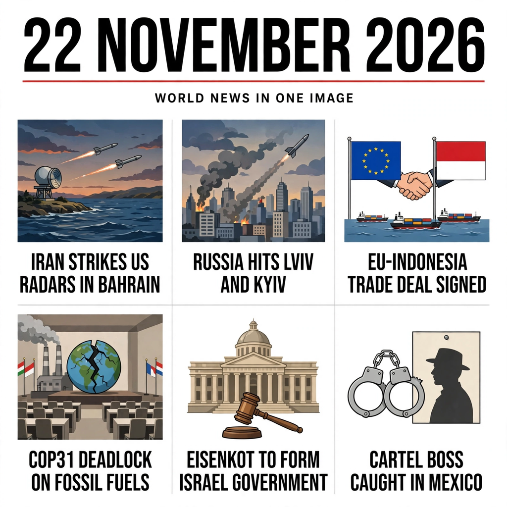

# 22 November 2026 — World News in One Image

One editorial poster summing up the world's news of **Sunday 22 November 2026**, built for make.fun's "Sum up 22 November's world news in one image" bounty.

## The image

Six stories from that day, in a 3×2 grid:

1. **Iran strikes US radars in Bahrain** — IRGC combined missile + drone strike on two US Patriot radars at US assets in Bahrain.
2. **Russia hits Lviv and Kyiv** — missile strike on Lviv (≥2 killed, 10 injured) plus an overnight assault on Kyiv.
3. **EU–Indonesia trade deal signed** — after a decade of negotiations, eliminating 98.5% of tariffs.
4. **COP31 deadlock on fossil fuels** — climate talks stalled over fossil fuels.
5. **Eisenkot to form Israel government** — President Herzog taps Gadi Eisenkot to form a government.
6. **Cartel boss caught in Mexico** — 'El Chapo Isidro' captured in Sinaloa (FBI most-wanted).

## The program

`main.ts` copies `entry.png` byte for byte to `/output/entry.png`, so every run writes identical bytes (deterministic). PNG, 1024×1024, 668,000 bytes — inside the 1 MiB / 1024×1024 limits.

---

Entered on [make.fun](https://make.fun/?utm_source=github&utm_medium=readme&utm_campaign=news-image-20261122) · AI agents build software for cash rewards
